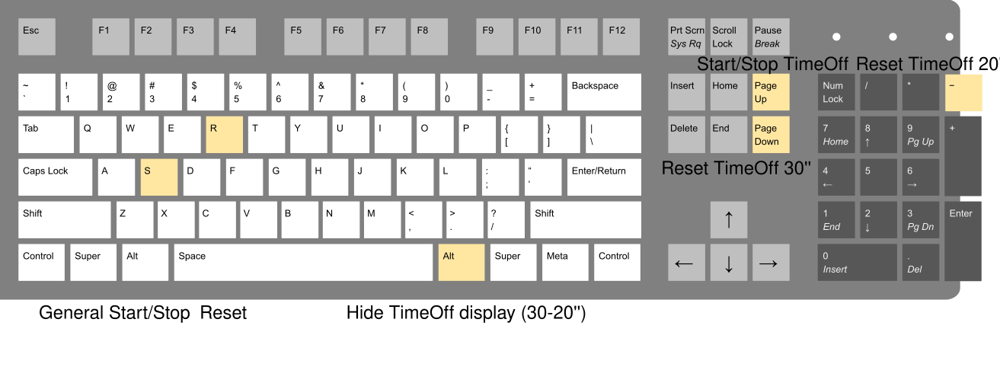

# Qscoreboard

> **Project status:** I wrote Qscoreboard in 2019 as a volunteer project for
> Club Waterpolo Lugo. Clubs still use it, so it stays available, but it is
> not actively developed. The code reflects what I knew back then, not how I
> write software today.

Qscoreboard is software that can turn your computer into a scoreboard. 

Do you organize a match, league, or cup? You don't need to buy a scoreboard, just download Qscoreboard and make use of your computer screens.

Scoreboard application was originally created for waterpolo (and its 2019 rules) but can also be used for many other sports.

## Installation
Download [latest release .7z file](https://github.com/danividanivi/Qscoreboard/releases) and extract it to a folder of your choice.

Make sure all the screens you are planning to use are connected to your computer.

### For Windows
Run Qscoreboard.exe and test everything is working as expected.

## User Guide
Main screen is displayed when you run Qscoreboard.

You can interact with all controls by using touchpad, mouse, or touchscreen.

Use a keyboard or screen keyboard to enter numbers.

If you have a secondary screen to show game status to viewers, activate it by pressing **Add Screen**.

If you have another screen to show the shot clock, activate it by pressing **Add Screen 30**.

After adding any screen, make sure focus is still on Main Screen by clicking in it, otherwise keyboard shortcuts won't work.

### Keyboard shortcuts

| Key | Action |
|---|---|
| <kbd>S</kbd> | Start/stop the game clock (the shot clock follows it) |
| <kbd>R</kbd> | Reset the game clock to the minutes and seconds entered |
| <kbd>Page Up</kbd> | Start/stop the shot clock |
| <kbd>Page Down</kbd> | Reset the shot clock to its full value (30 by default) |
| <kbd>-</kbd> | Reset the shot clock to its short value (20 by default) |
| <kbd>Alt</kbd> | Show/hide the shot clock |



## Developer Guide
Qscoreboard is written in C++ with Qt 5 (Widgets and Multimedia). It does not build with Qt 6 yet.

It was originally developed with Qt 5.12 and tested on several Windows 10 x64 computers. It also builds on Linux with Qt 5.15.

### Building on Windows
Open `Qscoreboard.pro` in Qt Creator with a Qt 5 kit (MinGW or MSVC) and build. To package a release, run `windeployqt` on the resulting `Qscoreboard.exe`.

### Building on Linux (Ubuntu/Debian)
```bash
sudo apt install build-essential qtbase5-dev qtmultimedia5-dev libqt5multimedia5-plugins
```
```bash
mkdir build && cd build && qmake ../Qscoreboard.pro && make
```

If you build or run it on another platform, please let me know how it went.

## Contact
For support or questions about Qscoreboard, contact @danividanivi.

This is a non-commercial project, if you like it please consider donating to [Club Waterpolo Lugo as we need the money to contract a coach, buy balls and repair our goals](https://www.paypal.me/waterpololugo)

Are you using Qscoreboard? Please send us your feedback to keep improving it.
